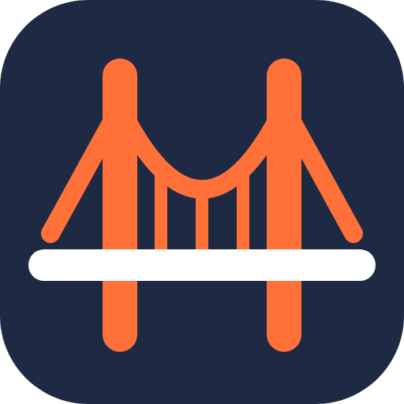
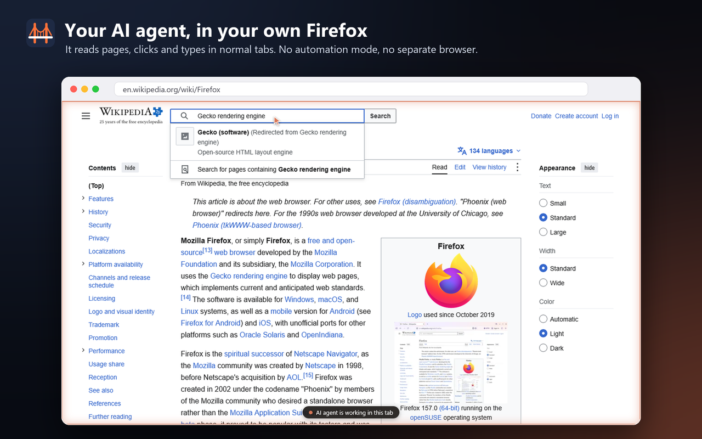
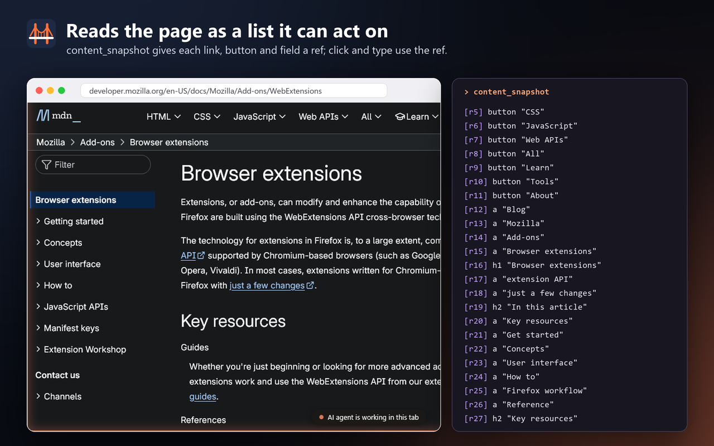
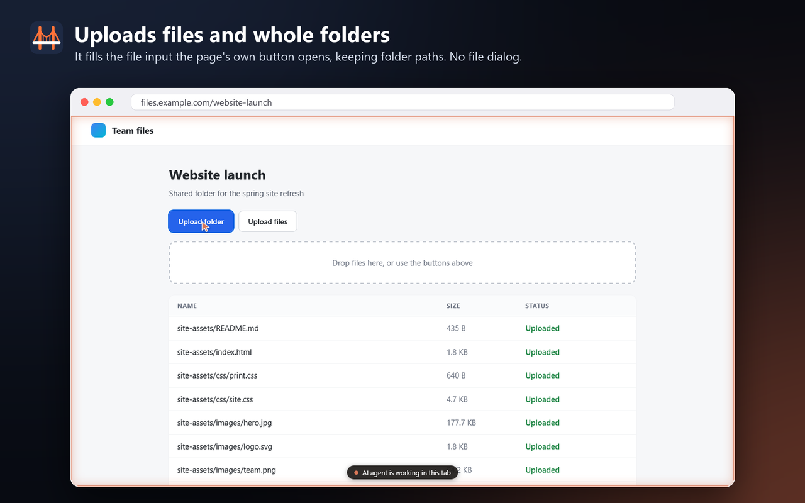

# MCP Bridge for Firefox



Let Claude, Cursor or any MCP client use your everyday Firefox. The agent can read pages, click, type, upload files and whole folders, and take screenshots, in the tabs you already have open and signed in.

It is a regular Firefox add-on plus a small local MCP server. Firefox does **not** run in automation mode: no `navigator.webdriver`, no striped address bar, no special launch flags. Tools built on Marionette or WebDriver BiDi (Playwright, Selenium, firefox-devtools-mcp) need those, and sites with bot checks notice.

Based on [FoxMCP](https://github.com/ThinkerYzu/foxmcp) by ThinkerYzu (MIT). The interaction, overlay, upload and reconnect changes are also offered upstream as pull requests.

[](docs/media/launch.mp4)

[Watch the video with sound (MP4, 21 s)](docs/media/launch.mp4)

| | | |
|---|---|---|
|  |  |  |

## What it can do

- **Read and act on pages:** list a page's interactive elements with stable refs, then click, double-click, type into and press keys on them. Typing works with React and Vue inputs.
- **Upload files and folders:** put a local file or a whole folder on a page's file input. Folders keep their structure where the site supports folder upload, and buttons that open a file dialog are handled without the dialog.
- **See what it's doing:** while the agent acts on a tab, an orange border, a label and a moving cursor show it. They fade when it stops and stay out of screenshots.
- **Tabs, windows, navigation, screenshots, history, bookmarks** and **network request monitoring**, from FoxMCP.
- **Any MCP client:** Claude Code, Claude Desktop, Cursor, VS Code, Codex, Gemini CLI and others.

## Several Firefox profiles

Run the add-on in as many profiles as you like. All of them connect to the one
server; `browsers_list` shows them and `browsers_select` picks the one the agent
works in. Set each profile's name on the add-on's options page. Details:
[docs/configuration.md](docs/configuration.md#several-firefox-profiles).

## Install

### 1. The add-on

Install **MCP Bridge for Firefox** from Firefox Add-ons (listing in review). Until then, install the signed build from this repo's releases: download [mcp-bridge-for-firefox-1.8.0.xpi](https://github.com/MashdorDev/mcp-bridge-for-firefox/releases/download/v1.8.0/mcp-bridge-for-firefox-1.8.0.xpi) and open it in Firefox.

### 2. The MCP server, in one command

The server runs inside your AI client, which starts it when a session starts. With [uv](https://docs.astral.sh/uv/) installed, this downloads, installs and registers it for Claude Code (no clone, no virtualenv):

```bash
claude mcp add firefox -- uvx --from git+https://github.com/MashdorDev/mcp-bridge-for-firefox@v1.8.0 mcp-bridge-for-firefox --stdio
```

Then restart Claude Code, or run `/mcp` and reconnect. The add-on's toolbar popup shows the same command, with a Copy button, whenever it has no server to talk to.

Any client that reads an `mcp.json` (Cursor, Claude Desktop, VS Code):

```json
{
  "mcpServers": {
    "firefox": {
      "command": "uvx",
      "args": ["--from", "git+https://github.com/MashdorDev/mcp-bridge-for-firefox@v1.8.0", "mcp-bridge-for-firefox", "--stdio"]
    }
  }
}
```

To run it from a clone instead (Python 3.10 or newer):

```bash
git clone https://github.com/MashdorDev/mcp-bridge-for-firefox.git
cd mcp-bridge-for-firefox
python -m venv venv
venv/bin/pip install .                                  # Windows: venv\Scripts\pip
claude mcp add firefox -- /path/to/mcp-bridge-for-firefox/venv/bin/mcp-bridge-for-firefox --stdio
```

The add-on connects to the server on `localhost:8765` and keeps retrying while none is running, so start order doesn't matter. Each Claude session starts its own server; the second one takes the next free port, and the add-on connects to all of them, so several sessions can use the browser at once. See [docs/configuration.md](docs/configuration.md).

## Privacy

The add-on sends page content, tab URLs, bookmarks, history and network activity only to the MCP server on your own machine, and only when your AI client asks for it. From there it goes to the AI client you connected, and to that client's provider. Nothing is sent to us. See [PRIVACY.md](PRIVACY.md).

Use it with AI clients you trust, and consider a separate Firefox profile for agent work.

## Docs

- [Tools reference](docs/api-reference.md)
- [Configuration](docs/configuration.md)
- [Protocol between server and add-on](docs/protocol.md)
- [Architecture](docs/architecture.md)
- [Security model](SECURITY.md)

## Limits

- Clicks and typing are synthetic events. Most sites accept them; a few ignore them, such as some login forms and anti-bot checks.
- Pages Firefox protects from add-ons (`about:` pages, addons.mozilla.org) can't be driven.
- Uploads stream through the local connection in 512 KB chunks: fine for project files, slow for multi-gigabyte ones.

## License

MIT. See [LICENSE](LICENSE). Copyright notices from FoxMCP are kept in the source files.
